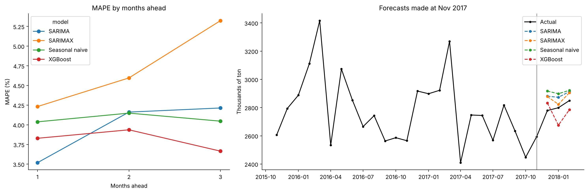
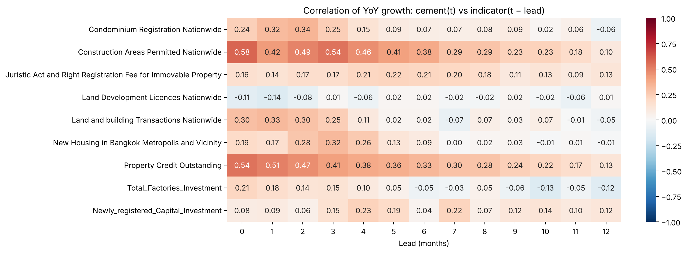

# Forecasting Thailand's Construction Material Demand

In this project I try to forecast how much cement Thailand will buy in the coming months, using public data from the Bank of Thailand.

Cement is hard to stockpile and expensive to move around, so a producer that can see demand a few months ahead can plan production and delivery much better. I wanted to find out two things: how far ahead cement demand can actually be predicted, and whether property and construction indicators help.

The full analysis is in [`CPAC_project.ipynb`](CPAC_project.ipynb). You can read it here on GitHub with all the charts, or run it yourself in Colab:

[](https://colab.research.google.com/github/KczePK/Forecasting-Thailand-s-Construction-Material-Demand/blob/main/CPAC_project.ipynb)

(In Colab, go to Runtime > Run all. The data loads from this repo, so there is nothing to upload.)

## What I found

- Cement demand is mostly seasonal. Sales peak in March and drop in April because of Songkran. After 2014 the overall level stayed flat at around 2.8 million tons a month.
- Construction permits and property credit move about 3 months before cement sales do, which makes sense: a project gets a permit and financing before anyone pours concrete.
- The models only beat a simple "same month last year" forecast up to about 3 months ahead. Further out than that, the simple forecast was as good as anything I tried.
- No single model won everywhere. SARIMAX was best 1 month ahead and XGBoost was best 3 months ahead, but the differences are small.

Average forecast error (MAPE, %) from testing each model at 24 different points in time:

| Model | 1 month ahead | 3 months ahead | 6 months ahead |
|---|---|---|---|
| Same month last year (baseline) | 4.05 | 4.08 | **3.98** |
| SARIMA | 3.25 | 3.96 | 4.25 |
| SARIMAX (with property indicators) | **3.16** | 4.72 | 4.44 |
| XGBoost | 3.76 | **3.81** | 4.89 |

To put that in tons: sales are about 2,800 thousand tons a month, so every 1% of error means roughly 28 thousand tons a month produced that wasn't needed, or needed but not produced.





## How I tested the models

My first version gave results that looked too good. The models were using data they wouldn't have had at the time of the forecast (for example, the actual permit numbers for the months being predicted). In the final version:

- Every model only sees data up to the day the forecast is made.
- Property indicators are delayed by the forecast horizon, so a 3-month forecast only uses indicators from 3 or more months earlier.
- Instead of one train/test split, I repeat the forecast at 24 different starting months and average the errors.

The gains got smaller after this, but I trust them a lot more.

## Data

All the data comes from the Bank of Thailand's [BOTWEBSTAT](https://app.bot.or.th/BTWS_STAT/statistics/BOTWEBSTAT.aspx?reportID=857&language=ENG) database. The files in `data/` are the original exports saved as CSV, with nothing changed.

| File | What's in it | Period |
|---|---|---|
| `EC_EI_016_S2.csv` | Private investment indicators, including domestic cement sales | Jan 2000 - Feb 2018 |
| `EC_EI_009_S2.csv` | Property indicators (permits, credit, condo registrations...) | Jan 2008 - Nov 2025 |
| `EC_EI_004_S2.csv` | Private investment index, including the construction material sales index | Jan 2010 - Dec 2024 |

BOT stopped publishing the cement series in February 2018, which is why the analysis ends there.

The BOT Excel exports are awkward to work with because the categories are only shown by indenting the labels, and the same name (like "Total investment") appears under several headings. `bot_clean.py` reads the indentation and gives every series a unique name, so I can select data by name instead of by row number.

Data derived from the Bank of Thailand Statistics Database, used under the terms and conditions published by the Bank of Thailand.

## Limitations and next steps

- The data stops before COVID-19, so these models have never seen a shock like that.
- About 8 years of monthly data is not much, especially for machine learning.
- BOT revises its numbers after first release, and I used the final figures. A real forecast would be slightly less accurate.
- Next I want to run the same approach on the construction material sales index (2010-2024), which covers the COVID period, and add forecast ranges instead of single numbers.

## How I built this

I chose the problem, found and selected the BOT datasets, did the exploratory analysis and decided how to frame the results for a business audience.

I used an AI assistant (Claude) as a coding partner and reviewer:

- `bot_clean.py` was written with AI help. I gave it the problem (BOT's repeated labels and indented categories) and checked that its output matched my original cleaning exactly.
- AI helped me restructure the modelling code into a reusable backtest, and reviewed my first version. That review is how I found the data leakage described above.
- AI helped me edit the text of the notebook and this README.

I reviewed and ran every part of the code myself, and I can explain each modelling decision.

## Running it locally

```bash
git clone https://github.com/KczePK/Forecasting-Thailand-s-Construction-Material-Demand.git
cd Forecasting-Thailand-s-Construction-Material-Demand
pip install -r requirements.txt
jupyter lab
```

Nawa Penparkgoon
